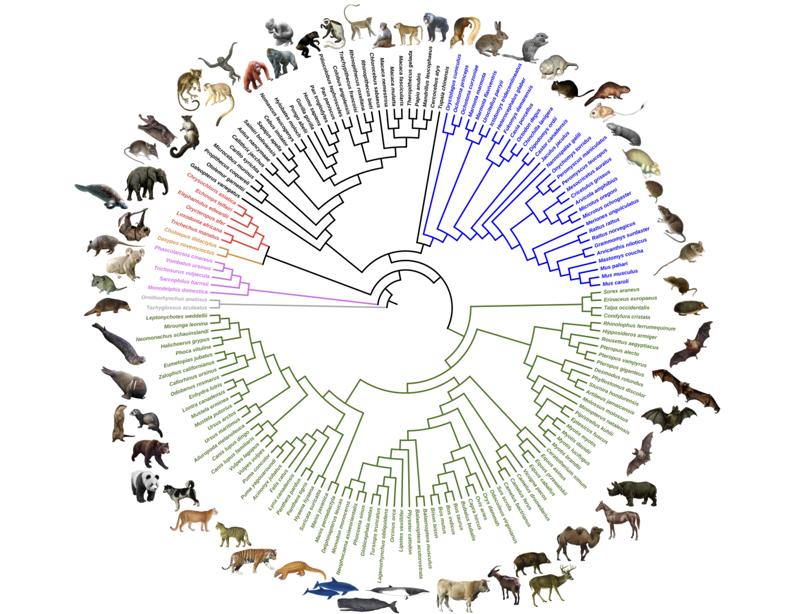

# Project Repository

## Overview

The goal of the bioinformatics project is to give you hands-on experience formulating a well-defined research question that can be addressed with genomic data, selecting appropriate computational methods, and building a fully documented, reproducible analysis pipeline.

## Instructions

1. **Work in your assigned group.** See work groups below.
2. **Obtain your dataset.** Each group will download a dataset of ten orthologous loci from ten mammal species, obtained from the [OrthoMaM database](https://orthomam.mbb.cnrs.fr/orthomam_v4/), along with instructions outlining the required analyses, from this repository.
3. **Design and carry out the analysis.** Each group will:
   - Formulate a research question that can be addressed with the dataset and the required analyses
   - Select and justify appropriate computational methods
   - Develop and run the analysis pipeline
   - Write a detailed tutorial documenting every computational step and the overall workflow
4. **Create the project repository.** Each group will create a GitHub repository. The repository will host the tutorial, together with the scripts and supporting files needed to reproduce the analysis.
5. **Present the project.** Each group will deliver a 10-minute presentation on their project. The presentation accounts for 30% of the final project grade.

## Species and Reference Phylogeny

The dataset includes the following ten mammal species:

*Ornithorhynchus anatinus*, *Monodelphis domestica*, *Dasypus novemcinctus*, *Loxodonta africana*, *Tursiops truncatus*, *Canis familiaris*, *Myotis brandtii*, *Pongo abelii*, *Tupaia belangeri*, and *Mus musculus*.

The figure below shows the OrthoMaM species tree for all mammals in the database.

  

## Required Analyses

Each group will complete the following analyses with its ten loci. Examples of tools are given in parentheses, but you may use any appropriate tool, provided you justify your choice in the tutorial.

1. **Download the data.** Download the dataset for your group from the class GitHub repository (for example, with `git clone` or by downloading the files directly from GitHub). Describe the files you obtained and their format.
2. **Identify the loci.** Use BLAST to identify each of the ten loci (for example, BLAST against the NCBI nucleotide database). Summarize the results in a locus table listing, for each locus, the gene name and a brief description of its function.
3. **Align the sequences.** Build a multiple sequence alignment (MSA) for each locus (for example, MAFFT). Add the alignment length (number of sites) for each locus to the locus table from step 2.
4. **Infer ML gene trees.** For each MSA, select the best-fitting substitution model and infer a maximum likelihood (ML) tree with branch support values (for example, IQ-TREE with ModelFinder and ultrafast bootstrap). Add the best-fitting model and the log-likelihood of the ML tree for each locus to the locus table.
5. **Infer a concatenated ML tree.** Concatenate the ten alignments into a single supermatrix and infer an ML tree, using a partitioned analysis with the best-fitting model for each partition (for example, IQ-TREE with a partition file). Report the log-likelihood of the concatenated ML tree.
6. **Infer a species tree under the multispecies coalescent.** Use the ten ML gene trees from step 4 to estimate a species tree (for example, ASTRAL).
7. **Plot the trees.** Plot the concatenated ML tree and the ASTRAL species tree, rooted with the outgroup *Ornithorhynchus anatinus* and showing branch support values (for example, FigTree, or plotting libraries in R or Python).
8. **Compare the trees and discuss.** Compare the two trees and identify any nodes where they differ (for example, using the Robinson–Foulds distance). Discuss possible reasons for any differences, such as incomplete lineage sorting, gene tree estimation error, limited phylogenetic signal in individual loci, or model choice. If the trees agree, discuss why.

## Repository Requirements

The tutorial in the GitHub repository must include the following:

1. **About section.** State the research goal, explain why you chose the approach presented, and describe alternative approaches that could be considered. If you tested and rejected any alternatives, explain why.
2. **Step-by-step documentation.** Document every step of the analysis, including simple text and data manipulations. For each step, provide:
   - A description of the tool used
   - The relevant options available
   - Any caveats to using the tool
   - The exact command used in the project
3. **Challenges.** Describe any challenges you encountered, whether minor or significant, and how you resolved them.
4. **Bibliography.** Provide a brief list of citations for the computational tools used.
5. **Use of AI tools.** Explicitly report any use of AI tools in the project. State which tools were used, for which tasks (such as writing or debugging code), and how you verified their output. If no AI tools were used, state this.

There is no length requirement, but the tutorial must be detailed enough for anyone to fully reproduce your analysis by following it.

<b>Work Groups</b>

| Name                    | Group |
|-------------------------|:-----:|
| Kamil Rampatsingh       | 1     |
| Zain Akhtar             | 1     |
| Alayna Cantrell         | 2     |
| Angel Cordova           | 2     |
| Marcelle Vaval          | 2     |
| Averi Schirmers         | 3     |
| Michelle Kordov         | 3     |
| Sofia Hernandez-Suarez  | 3     |
| Andres Gonzalez         | 4     |
| Eva Merhi               | 4     |
| Saptarshi Banik         | 4     |
| Meghan Cegielski        | 5     |
| Patrick Biernat         | 5     |
| Rowan Luzzi             | 5     |
| Patch Shields           | 6     |
| Sam Watson              | 6     |
| Theda Wilkens           | 6     |

## References

Allio R, Delsuc F, Belkhir K, Douzery EJP, Ranwez V, Scornavacca C. 2024. OrthoMaM v12: a database of curated single-copy ortholog alignments and trees to study mammalian evolutionary genomics. *Nucleic Acids Research* 52(D1): D529–D535. https://doi.org/10.1093/nar/gkad834

Katoh K, Standley DM. 2013. MAFFT multiple sequence alignment software version 7: improvements in performance and usability. *Molecular Biology and Evolution* 30(4): 772–780. https://doi.org/10.1093/molbev/mst010

Minh BQ, Schmidt HA, Chernomor O, Schrempf D, Woodhams MD, von Haeseler A, Lanfear R. 2020. IQ-TREE 2: new models and efficient methods for phylogenetic inference in the genomic era. *Molecular Biology and Evolution* 37(5): 1530–1534. https://doi.org/10.1093/molbev/msaa015

OrthoMaM database: https://orthomam.mbb.cnrs.fr/orthomam_v4/

Ranwez V, Delsuc F, Ranwez S, Belkhir K, Tilak MK, Douzery EJP. 2007. OrthoMaM: a database of orthologous genomic markers for placental mammal phylogenetics. *BMC Evolutionary Biology* 7: 241. https://doi.org/10.1186/1471-2148-7-241

Zhang C, Rabiee M, Sayyari E, Mirarab S. 2018. ASTRAL-III: polynomial time species tree reconstruction from partially resolved gene trees. *BMC Bioinformatics* 19(Suppl 6): 153. https://doi.org/10.1186/s12859-018-2129-y
